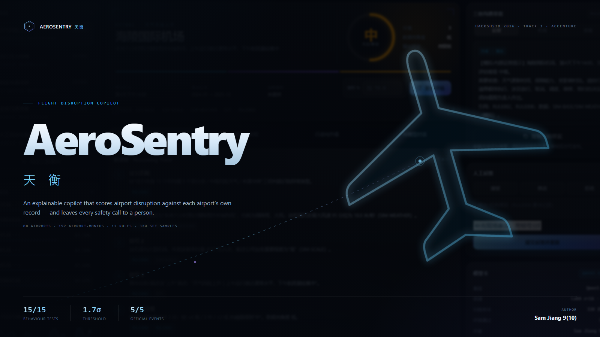

# AeroSentry 天衡

**An explainable AI copilot for flight-disruption response at key airports.**

HackSHSID 2026 · Track 3 (Accenture) · Sam Jiang 9(10)

Open **[`index.html`](index.html)** in any browser. No install, no server, no internet.

**→ Full guide: [TUTORIAL.md](TUTORIAL.md)** — usage, model hookup, training, troubleshooting.

---

## The problem

When weather turns at a key airport and two source systems disagree, someone has minutes to
decide what to check first, which number to trust, and when to escalate. Most tools answer a
different question — *will this flight be delayed?* — which is the one question nobody can
answer with the data available.

AeroSentry answers the question that can be answered: **what do we know, what do we not know,
what should we verify first, and who has to decide.**

## How it decides

| Step | What happens |
|---|---|
| **1 · Define** | A disruption is: an airport's monthly indicator ≥ 5 percentage points below its own 12-month mean, **or** a medium/high weather alert with no formal operating status, **or** an unresolved conflict between sources. |
| **2 · Weigh** | Independent signals are scored and summed — weather, indicator deviation, downstream task concentration, business weight, trend language, prior escalation. The ledger is printed, not hidden. |
| **3 · Grade** | `≥ 4 → high`, `3 → medium`, `≤ 2 → low`. Conflicting or unreliable sources return **undetermined** instead of a guess. |
| **4 · Act** | Actions are ordered by what is most decisive and most time-critical, each with an owner, a deadline and the rule that fired. |
| **5 · Speak** | Three drafts from one set of facts: operations, airport coordination, passengers. The passenger version is always marked *draft — requires human review*. |

Every figure carries a source (`SIM-BASE`, `SIM-SCALE`, `SIM-WEATHER`, `EVT`). Every judgement
carries a rule (`RULE001`–`RULE012`).

## The Qwen model

The page runs on a **deterministic engine written in JavaScript**, which is why it works offline.
A fine-tuned **Qwen3.5-9B (LoRA)** sits on top when available and turns the structured assessment
into natural conversation.

Click **连接模型** in the top bar and paste an OpenAI-compatible endpoint:

```
http://127.0.0.1:11434/v1/chat/completions     (Ollama)
http://127.0.0.1:8080/v1/chat/completions      (llama.cpp)
```

If the endpoint is unreachable, the page falls back to the engine and every conclusion stays
identical. The model changes *how it explains*, never *what is true* — so it cannot invent a
number. See [`model/`](model/) for the Modelfile.

## Results

| | |
|---|---|
| Official behaviour tests | **15 / 15** |
| Official events | EVT001 中 · EVT002 低 · EVT003 无法判断 · EVT004 低 · EVT005 低 |
| Reference match | EVT001 recomputes to 3 points → medium, matching the organiser's answer |
| Threshold | 5 pp ≈ **1.7 σ**, only **6.2 %** of 192 airport-months |

## Files

```
index.html               the entire application — HTML + CSS + engine + data (145 KB)
cover.png                1600×900 cover
cover-social.png         1280×640 social preview
TUTORIAL.md              full guide: usage, training, troubleshooting (Chinese)
model/
  Modelfile.aerosentry   Ollama model definition
  README.md              how to train and attach the model
```

## Note on the data

Every airport, city, event and value here is **simulated** and was generated by the organisers
of HackSHSID 2026. Nothing corresponds to a real airport or a real operation (`RULE010`).
AeroSentry is decision support only: flight release, cancellation, dispatch, maintenance and
compensation always remain with qualified airline staff (`RULE007`).

---

Built by **Sam Jiang 9(10)**.
